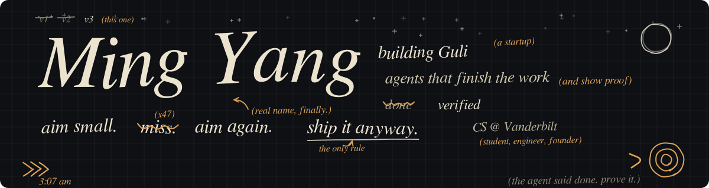
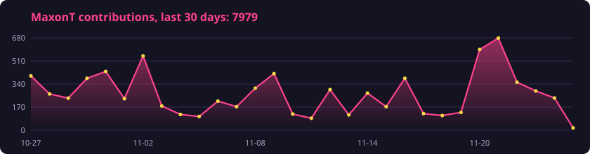

## 🏹 About this profile

  

<i>Before any of this had a name.</i>

<i>First-gen by circumstance, idealist by birth, realist by limit. No inherited playbook, just intergenerational priors, an unfortunate amount of existential debt, and a pathological appetite for becoming.</i>

<i>For a while, fear handled the reward modeling and social approval supplied the loss function. A quite elegant optimization scheme, until the optimizer started consuming its own operator.</i>

<i>The subsequent policy recalibration involved replacing heteronomous teleologies with epistemic sovereignty, reallocating probability mass from performative survival to agency, and treating code-as-truth, autonomous systems, and worldmaking as instruments of existential self-authorship.</i>

<i>No ergodic guarantees. No benevolent universe. Still, one human attempting to bootstrap meaning out of contingency, one absurdly ambitious side quest at a time.</i>

<i>The Absolute Idea unravel, its light cascading over the ruins of inherited teleologies, baptizing the unfinished self in the unbearable lucidity of becoming.</i>

<i>Reality update the posterior. Never let it rewrite the objective function.</i>

<i>Find yourself</i>

I'm an AI Engineer and Founder at Guli, working on AI agents and automation.

I love contributing to open source and actively helping the developer community through pull requests, code reviews, and collaboration. I'm also focused on building my own startup, Guli.

If anything here is useful to you, please leave a ⭐ on the repo and [follow me](https://github.com/MaxonT?tab=followers). It really keeps me going.

Flisk: [PR #4973 merged](https://github.com/flisk-sh/flisk/pull/4973). Hall of Fame is confirmed; Founding Contributor requires a separate claim.

## 🧰 Tech stack

  

## 📊 GitHub stats

  
  

  

  

## 🧪 github2 · the lab

One bigger open-source system at a time. Click a card to open it.

<table>
<tr>
<td width="50%" valign="top">

 · <a href="https://github.com/MaxonT/TRACES.md"><b>Open TRACES.md →</b></a>

</td>
<td width="50%" valign="top">

 · <a href="https://github.com/MaxonT/aisync"><b>Open aisync →</b></a>

</td>
</tr>
<tr>
<td width="50%" valign="top">

 · <a href="https://github.com/MaxonT/existence-trace"><b>Open existence-trace →</b></a>

</td>
<td width="50%" valign="middle" align="center">
<b>What ties them together</b>  
Agents get rules (AGENTS.md). They should also leave a record (TRACES.md), talk to each other (aisync), and the same loop works for a person (existence-trace).  
<a href="https://github.com/MaxonT?tab=repositories&q=top-&type=source">Also: star-ranked <code>top-*</code> lists (github1) →</a>
</td>
</tr>
</table>

## 🏆 Latest Projects

Refreshed automatically every hour, star counts are live.

<!-- LATEST:START -->
| Project | ⭐ | Updated | What it is |
|:--|:-:|:-:|:--|
<!-- LATEST:END -->

🧪 Currently exploring (click to open)

 

- 🤖 Agent observability: what an agent did, and how to learn from its failures
- 🧠 Evaluation first: small test sets that tell me whether an AI tool is actually better
- 🎓 Learning science applied to quizzes, spaced review and study plans
- 🌐 Bilingual docs and tools (English and 中文) as a default, not an afterthought

## ⭐ Leave a star?

Every star tells me someone found my work useful. 
One click on any of these makes my day:

⭐ If something here helped you, a star means a lot. This repo was previously named <b>MaxonT</b>.

