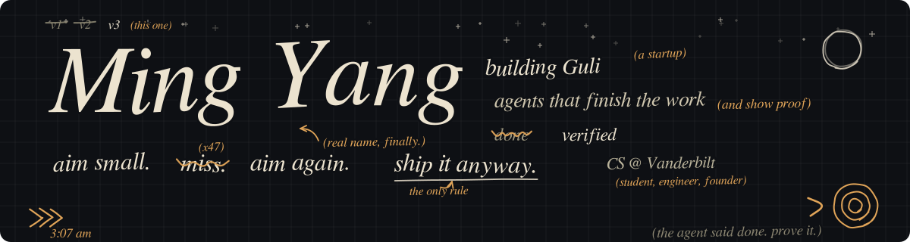
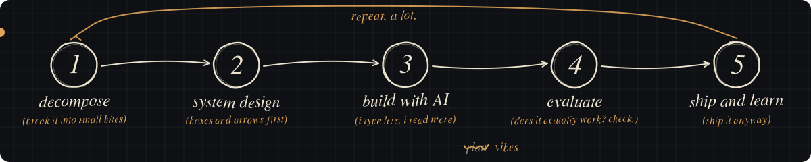
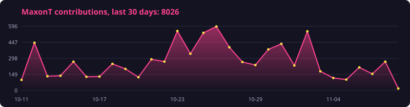
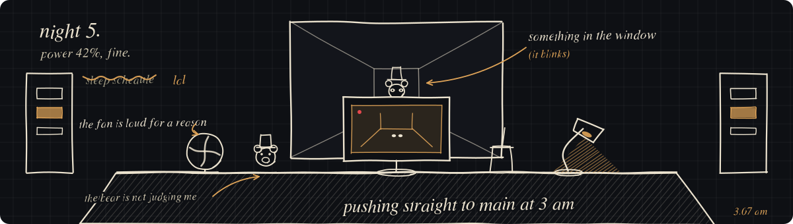

# Ming (Tiger) Yang | Building Guli

Startup Founder · AI Agent Operations · CS @ Vanderbilt

I'm building Guli, a startup exploring how AI agents can move from answering questions to reliably getting real work done.

My current focus is a simple question: when we delegate a task to an AI agent, how do we know it was actually completed?

I build software, explore agent systems, and turn ideas into practical tools.

## 🧭 What I'm building

Guli is building an operating platform for AI agents. The aim is to help people delegate real work to AI systems and then reliably understand whether that work was completed.

An agent that reports "done" has only told you something. The hard part is knowing it is true, and knowing what to do when it is not. That gap is the problem I care about.

Our initial focus:

| Area | The question behind it |
|:--|:--|
| Task fulfillment | Did the agent do the job that was asked? |
| Verification | What evidence shows the work was completed? |
| Reliability | Does it hold up run after run, not only once? |
| Recovery | When a task fails, how does the work get back on track? |

Security and safety are foundational principles in how we build. They are part of the work, not the whole of it.

## 🧪 Selected engineering and open source

Personal open-source experiments on the same questions. They are not Guli products. Click a card to open the repo.

<table>
<tr>
<td width="50%" valign="top">

 · <a href="https://github.com/MaxonT/TRACES.md">Open TRACES.md →</a>

</td>
<td width="50%" valign="top">

 · <a href="https://github.com/MaxonT/aisync">Open aisync →</a>

</td>
</tr>
<tr>
<td width="50%" valign="top">

 · <a href="https://github.com/MaxonT/existence-trace">Open existence-trace →</a>

</td>
<td width="50%" valign="middle" align="center">
Three small experiments on one question: how do we know what an agent actually did?  Record it (TRACES.md). Coordinate it (aisync). Prove it was used (existence-trace).
</td>
</tr>
</table>

| Project | Problem it addresses | What it demonstrates | What it does today |
|:--|:--|:--|:--|
| [TRACES.md](https://github.com/MaxonT/TRACES.md) | After an agent finishes, there is no reliable record of what it did, and failures get lost. | An open spec with validators, so agent work can be checked without trusting the agent's own summary. | A plain-text format and a Python CLI (standard library only). One append-only file per task, one line per tool call, failures included. The validator rejects a trace that hides a failure. |
| [aisync](https://github.com/MaxonT/aisync) | Several AI coding tools edit the same codebase without knowing what the others are doing. | Coordination and conflict handling between agents. | A local hub with shared rules, file claims that stop two agents editing the same file, a hash-chained journal of decisions and commits, and hooks that tell a running session what the others just did. Works with Claude Code, Codex and Cursor on macOS and Linux. |
| [existence-trace](https://github.com/MaxonT/existence-trace) | An AI can read all of your code and still have no checkable memory of you. | An AI that has to prove it used what it knows. | Reads a daily journal in files you own, asks when it is unsure, turns your answers into rules, and keeps a receipt each time a rule changes a report. A reflection aid, not a clinical tool. |

## 🧰 Technical skills

  

## 📊 GitHub activity and projects

  
  

  

### Recent public repositories

Refreshed automatically every hour, star counts are live. The auto-maintained, star-ranked reference lists are collected [here](https://github.com/MaxonT?tab=repositories&q=top-&type=source).

<!-- LATEST:START -->
| Project | ⭐ | Updated | What it is |
|:--|:-:|:-:|:--|
| [awesome-agent-workflows](https://github.com/MaxonT/awesome-agent-workflows) |  | 2026-11-02 | Curated, star-ranked catalog of AI agent frameworks, coding-agent harnesses and workflow platform... |
| [reeta](https://github.com/MaxonT/reeta) |  | 2026-10-20 | Reeta: teach the AI student. HackTN26, Challenge #3 |
| [prompt-mirror](https://github.com/MaxonT/prompt-mirror) |  | 2026-10-12 | ai interations analysis statistic tool, see your interations with ai |
| [tweeter_prototype](https://github.com/MaxonT/tweeter_prototype) |  | 2026-10-12 | 🚀 A sleek UI demo for SocialMax, prototype social app interface built to explore design, layout a... |
| [learn_html_workshop](https://github.com/MaxonT/learn_html_workshop) |  | 2026-01-06 | 🔥This hands-on session will teach you how to build a beautiful, modern portfolio website using on... |
<!-- LATEST:END -->

🔬 What I am exploring (click to open)

 

- 🎯 Agent reliability: knowing whether a delegated task was actually completed, and recovering when it was not
- 🤖 Agent observability: what an agent did, and how to learn from its failures
- 🧠 Evaluation first: small test sets that tell me whether an AI tool is actually better
- 🎓 Learning science applied to quizzes, spaced review and study plans
- 🌐 Bilingual docs and tools (English and 中文) as a default, not an afterthought

🎮 Off duty: games and horror (click to open)

 

<i>3 AM and the hallway hums. A door that was shut a minute ago is open now, light leaking out like it has somewhere to be. Someone is standing in it, or maybe I am the one standing and the corridor is what moves. Nothing in the footage explains itself. Neither do I. The build is still green though.</i>

And because debugging at 3 AM feels exactly like surviving a night shift, here is a night shift scene I drew:

The repositories here are my personal open-source work. Guli is my startup.

