I love publishing repos: things I like and think might help someone else. Limited skills, very active, a new update roughly every 3 days.

## 🧪 github2 · the lab

One bigger open-source system at a time. Click a card to open it.

<table>
<tr>
<td width="50%" valign="top">

 · <a href="https://github.com/MaxonT/TRACES.md"><b>Open TRACES.md →</b></a>

</td>
<td width="50%" valign="top">

 · <a href="https://github.com/MaxonT/aisync"><b>Open aisync →</b></a>

</td>
</tr>
<tr>
<td width="50%" valign="top">

 · <a href="https://github.com/MaxonT/existence-trace"><b>Open existence-trace →</b></a>

</td>
<td width="50%" valign="middle" align="center">
<b>What ties them together</b>  
Agents get rules (AGENTS.md). They should also leave a record (TRACES.md), talk to each other (aisync), and the same loop works for a person (existence-trace).  
<a href="https://github.com/MaxonT?tab=repositories&q=top-&type=source">Also: star-ranked <code>top-*</code> lists (github1) →</a>
</td>
</tr>
</table>

## 🧰 Tech stack

  

  
  

📊 More stats and what I'm exploring

 

- 🤖 Agent observability: what an agent did, and how to learn from its failures
- 🧠 Evaluation first: small test sets that tell me whether an AI tool is actually better
- 🎓 Learning science applied to quizzes, spaced review and study plans
- 🌐 Bilingual docs and tools (English and 中文) as a default, not an afterthought

## 🎮 Off duty

 

<i>3 AM and the hallway hums. A door that was shut a minute ago is open now. Nothing in the footage explains itself. Neither do I. The build is still green though.</i>

🖊️ Two more sketches (night shift office, how I build)

 

## ⭐ Leave a star?

Every star tells me someone found it useful, and that is what keeps me shipping every 3 days. 
One click on any of these makes my day:

<a href="https://star-history.com/#maxont/traces.md&maxont/aisync&maxont/existence-trace&Date">
  <picture>
    <source media="(prefers-color-scheme: dark)" srcset="https://api.star-history.com/svg?repos=maxont/traces.md,maxont/aisync,maxont/existence-trace&type=Date&theme=dark">
    
  </picture>
</a>

Watch this line go up. Your star is one of the dots.

