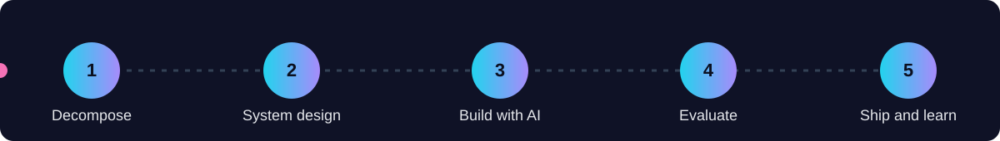

## 👋 About me

My name is Tiger Yang, a Computer Science student at Vanderbilt University. I like turning a messy everyday problem into a small tool that works: something that helps someone study faster, say things more clearly, or understand what their AI agents really did.

> 🧭 **How I work.** Break the problem down, design the system, build with AI, evaluate honestly, then ship and learn. Domain knowledge and good evaluation matter more to me than clever code.

## 🔥 Recent work

| | Project | What it does | Stack |
|:-:|:--|:--|:--|
| 🧾 | **[TRACES.md](https://github.com/MaxonT/TRACES.md)** | AGENTS.md, but for what agents did. A simple, open format (plus a stdlib CLI) for recording every tool call and result, failures included, so agent errors can be replayed and analyzed. |   |
| 🪞 | **[existence-trace](https://github.com/MaxonT/existence-trace)** | A self-improving personal state system. An AI agent reads your journal through emotion (PAD), security/hope and growth lenses, asks for feedback, and turns it into rules. |   |
| 🗂️ | **[awesome-agent-workflows](https://github.com/MaxonT/awesome-agent-workflows)** | A curated, star-ranked catalog of AI agent frameworks, coding-agent harnesses and workflow platforms, in English and 中文, auto-refreshed. |   |
| 📚 | **[QuizAll](https://github.com/MaxonT/quizall)** | Turn study materials into a learning plan, practice quizzes, and review notes. |  |
| 🧠 | **[Promptly](https://github.com/MaxonT/promptly)** | Rewrite a rough request into a clearer AI prompt while preserving its intent. |  |
| 🗓️ | **[MeetMesh](https://github.com/MaxonT/MeetMesh)** | A When2Meet-style scheduling mesh: share a link, let everyone paint their availability, and surface the best slots. |  |
| 💬 | **[SocialMax prototype](https://github.com/MaxonT/tweeter_prototype)** | A sleek social-app UI demo built to explore layout, design and interaction. |  |

🧪 Currently exploring (click to open)

 

- 🤖 Agent observability: what an agent did, and how to learn from its failures
- 🧠 Evaluation first: small test sets that tell me whether an AI tool is actually better
- 🎓 Learning science applied to quizzes, spaced review and study plans
- 🌐 Bilingual docs and tools (English and 中文) as a default, not an afterthought

## 🧰 Tech stack

  

## 📊 GitHub stats

  
  

  

  

## 🌍 Let's connect

I am always happy to chat about AI tools, study workflows, and open formats for agents. Say hi.

- 💼 LinkedIn: [Ming Yang](https://www.linkedin.com/in/ming-yang-14270837a)
- 📧 Email: [ming.t.yang@vanderbilt.edu](mailto:ming.t.yang@vanderbilt.edu)

⭐ If something here helped you, a star means a lot. This repo was previously named <b>MaxonT</b>.

