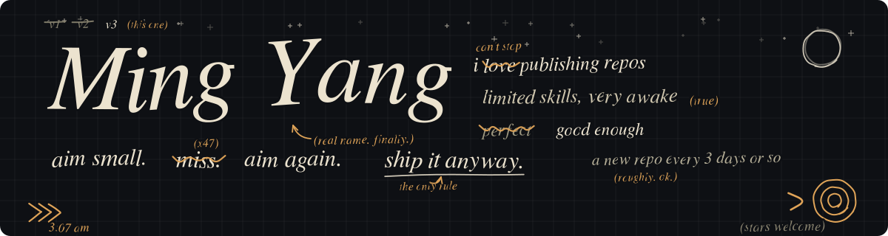

[English](README.md) · **简体中文**

## 🏹 关于这个主页

我喜欢发布 repo。发出来的大多是我自己喜欢、也觉得可能对别人有帮助的东西。我的技术能力有限，但我很积极，大约每 3 天更新一次。

## 🚀 主力系统

<table>
<tr>
<td width="33%" align="center" valign="top">

 🤝 所有 AI 编程工具的每日站会 

</td>
<td width="33%" align="center" valign="top">

 🛰️ agent 的飞行记录仪 

</td>
<td width="33%" align="center" valign="top">

 🧭 日记进，反馈循环，规则出 

</td>
</tr>
</table>

## 🏆 最近的项目

每天自动刷新两次，星数实时显示。

<!-- LATEST:START -->
| 项目 | ⭐ | 更新 | 做什么 |
|:--|:-:|:-:|:--|
| [**top-chinese-rainbow-fart**](https://github.com/MaxonT/top-chinese-rainbow-fart) |  | 2026-10-22 | Chinese internet compliment generators, rainbow-fart plugins, meme makers and joke corpora, ranke... |
| [**top-open-weight-coding-models**](https://github.com/MaxonT/top-open-weight-coding-models) |  | 2026-10-21 | Open-weight coding and agent models plus the tools to run them locally, ranked by GitHub stars |
| [**top-free-javascript-courses**](https://github.com/MaxonT/top-free-javascript-courses) |  | 2026-10-21 | Every free way to learn JavaScript, ranked by GitHub stars |
| [**top-flying-car-open-source**](https://github.com/MaxonT/top-flying-car-open-source) |  | 2026-10-21 | Open-source tools for flying cars, eVTOL and drones, ranked by GitHub stars |
| [**top-ai-agent-guardrails**](https://github.com/MaxonT/top-ai-agent-guardrails) |  | 2026-10-21 | Guardrails for AI agents: sandboxes, human-in-the-loop approval, cost limits, prompt-injection de... |
| [**awesome-agent-workflows**](https://github.com/MaxonT/awesome-agent-workflows) |  | 2026-10-21 | Curated, star-ranked catalog of AI agent frameworks, coding-agent harnesses and workflow platform... |
| [**reeta**](https://github.com/MaxonT/reeta) |  | 2026-10-20 | Reeta: teach the AI student. HackTN26, Challenge #3 |
<!-- LATEST:END -->

## 🧰 技术栈

  

## 🎮 下班时间

<i>凌晨三点，走廊在嗡嗡响。一分钟前还关着的门开了。画面从不解释自己，我也是。不过构建还是绿的。</i>

<table>
<tr>
<td width="50%"></td>
<td width="50%"></td>
</tr>
</table>

## ⭐ 点个 star 吧

每一颗 star 都是一句「这个有用」，它真的让我保持每 3 天更新一次。

