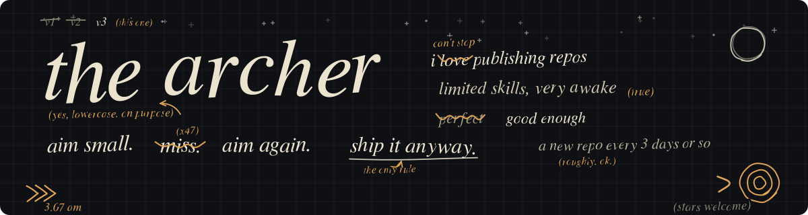

[English](README.md) · **简体中文**

## 🏹 关于这个主页

我喜欢发布 repo。发出来的大多是我自己喜欢、也觉得可能对别人有帮助的东西。我的技术能力有限,但我很积极,大约每 3 天更新一次。

如果这里的东西对你有用,请给仓库点个 ⭐,也欢迎 [关注我](https://github.com/MaxonT?tab=followers),这对我是很大的鼓励。

## 🎮 下班时间

<i>凌晨三点,走廊在嗡嗡响。一分钟前还关着的门开了,光漏出来,像赶着去哪里。有人站在光里,或者站着的是我,动的是走廊。画面从不解释自己,我也是。不过构建还是绿的。</i>

凌晨三点调 bug 就像在熬 FNAF 的夜班,所以画了一张夜班保安室:

## 🔥 最近在做的项目

| # | 项目 | 语言 | 更新 | 做什么 |
|:-:|:--|:-:|:-:|:--|
| 1 | **[TRACES.md](https://github.com/MaxonT/TRACES.md)** | Python | 2026-10-13 | 给 agent 用的行为记录开放格式,失败也如实记录,方便复盘和改进。 |
| 2 | **[existence-trace](https://github.com/MaxonT/existence-trace)** | Python | 2026-10-12 | 会自我改进的个人状态系统:AI 读日记,征求反馈,转成规则。 |
| 3 | **[tweeter_prototype](https://github.com/MaxonT/tweeter_prototype)** | JavaScript | 2026-10-12 | SocialMax 社交应用界面原型。 |
| 4 | **[awesome-agent-workflows](https://github.com/MaxonT/awesome-agent-workflows)** | Markdown | 2026-10-10 | 按 star 排序的 agent 项目精选清单,中英双语,自动刷新。 |

## 🧰 技术栈

  

## 🌍 联系我

- 🐙 GitHub: [@MaxonT](https://github.com/MaxonT)

