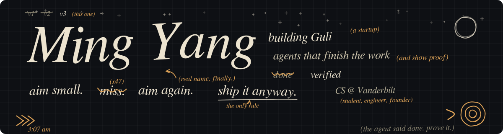
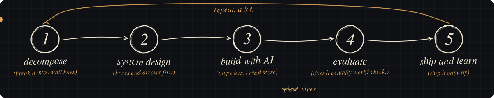
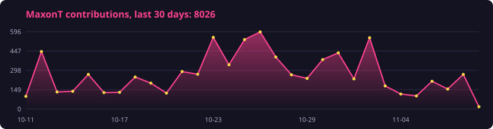
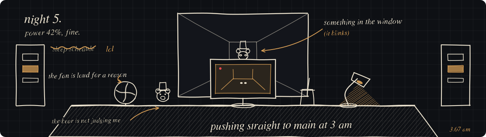

# Ming (Tiger) Yang | 正在做 Guli

创业者 · AI Agent 运营 · Vanderbilt 计算机系

[English](README.md) · 简体中文

我正在做 Guli，一家创业公司，探索 AI agent 如何从回答问题，走向可靠地把真实的工作做完。

我现在关注一个很简单的问题：把任务交给 AI agent 之后，怎么知道它真的做完了？

我写软件，研究 agent 系统，把想法做成实用的工具。

## 🧭 我在做什么

Guli 在做一个 AI agent 的运营平台。目标是让人可以把真实的工作交给 AI 系统，并且能可靠地知道这些工作有没有完成。

agent 说一句「做完了」，只是它告诉了你一件事。难的是确认这是真的，以及不是真的时该怎么办。这个缺口就是我在意的问题。

我们最初的重点：

| 方向 | 背后的问题 |
|:--|:--|
| 任务完成 | agent 做的是不是被要求的那件事？ |
| 验证 | 有什么证据能说明工作确实完成了？ |
| 可靠性 | 它能一次又一次稳定做到，而不只是一次吗？ |
| 恢复 | 任务失败后，工作怎样回到正轨？ |

安全是我们做事的基础原则，但它只是工作的一部分，不是全部。

## 🧪 精选的工程与开源项目

围绕同一批问题做的个人开源实验，不是 Guli 的产品。点卡片进入仓库。

<table>
<tr>
<td width="50%" valign="top">

 · <a href="https://github.com/MaxonT/TRACES.md">打开 TRACES.md →</a>

</td>
<td width="50%" valign="top">

 · <a href="https://github.com/MaxonT/aisync">打开 aisync →</a>

</td>
</tr>
<tr>
<td width="50%" valign="top">

 · <a href="https://github.com/MaxonT/existence-trace">打开 existence-trace →</a>

</td>
<td width="50%" valign="middle" align="center">
三个小实验，对着同一个问题： 怎么知道 agent 到底做了什么？  把它记下来（TRACES.md）。 让它们互相协调（aisync）。 证明它真的用了（existence-trace）。
</td>
</tr>
</table>

| 项目 | 解决的问题 | 它展示了什么 | 目前能做什么 |
|:--|:--|:--|:--|
| [TRACES.md](https://github.com/MaxonT/TRACES.md) | agent 做完之后，没有可靠的记录说明它做了什么，失败也容易丢。 | 一个带校验器的开放规范，不必相信 agent 自己的总结，也能检查它的工作。 | 纯文本格式加 Python 命令行（只用标准库）。每个任务一个只追加的文件，每次工具调用一行，失败也如实记录。校验器会拒绝隐瞒失败的记录。 |
| [aisync](https://github.com/MaxonT/aisync) | 好几个 AI 编程工具在同一个代码库里改东西，却不知道彼此在做什么。 | agent 之间的协调与冲突处理。 | 本地中枢：共享规则，防止两个 agent 同时改同一文件的文件认领，记录决策和提交的哈希链日志，以及把其他工具刚做的事告诉正在运行的会话的钩子。支持 macOS 和 Linux 上的 Claude Code、Codex 和 Cursor。 |
| [existence-trace](https://github.com/MaxonT/existence-trace) | AI 可以读遍你的代码，却对你这个人没有可核查的记忆。 | 一个必须证明自己用了所知内容的 AI。 | 读取你自己文件夹里的每日日记，不确定时发问，把你的回答变成规则，每次规则改变报告时留下凭证。它是自我反思的辅助工具，不是临床工具。 |

## 🧰 技术栈

  

## 📊 GitHub 动态与项目

  
  

  

### 最近的公开仓库

每小时自动刷新一次，星数实时显示。自动维护的、按 star 排序的参考清单集中在[这里](https://github.com/MaxonT?tab=repositories&q=top-&type=source)。

<!-- LATEST:START -->
| 项目 | ⭐ | 更新 | 做什么 |
|:--|:-:|:-:|:--|
| [awesome-agent-workflows](https://github.com/MaxonT/awesome-agent-workflows) |  | 2026-11-02 | Curated, star-ranked catalog of AI agent frameworks, coding-agent harnesses and workflow platform... |
| [reeta](https://github.com/MaxonT/reeta) |  | 2026-10-20 | Reeta: teach the AI student. HackTN26, Challenge #3 |
| [prompt-mirror](https://github.com/MaxonT/prompt-mirror) |  | 2026-10-12 | ai interations analysis statistic tool, see your interations with ai |
| [tweeter_prototype](https://github.com/MaxonT/tweeter_prototype) |  | 2026-10-12 | 🚀 A sleek UI demo for SocialMax, prototype social app interface built to explore design, layout a... |
| [learn_html_workshop](https://github.com/MaxonT/learn_html_workshop) |  | 2026-01-06 | 🔥This hands-on session will teach you how to build a beautiful, modern portfolio website using on... |
<!-- LATEST:END -->

🔬 我在研究什么（点击展开）

 

- 🎯 Agent 可靠性：知道交出去的任务是否真的完成，没完成时怎么恢复
- 🤖 Agent 可观测性：agent 做了什么，以及怎样从它的失败里学到东西
- 🧠 先做评估：用小型测试集判断一个 AI 工具是不是真的更好
- 🎓 把学习科学用在测验、间隔复习和学习计划上
- 🌐 中英双语的文档和工具作为默认，而不是事后补上

🎮 下班时间：游戏与恐怖（点击展开）

 

<i>凌晨三点，走廊在嗡嗡响。一分钟前还关着的门开了，光漏出来，像赶着去哪里。有人站在光里，或者站着的是我，动的是走廊。画面从不解释自己，我也是。不过构建还是绿的。</i>

凌晨三点调 bug 就像在熬 FNAF 的夜班，所以画了一张夜班保安室：

这里的仓库是我个人的开源作品。Guli 是我的创业项目。

