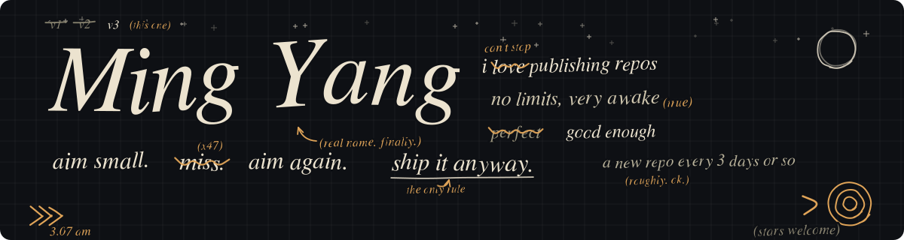
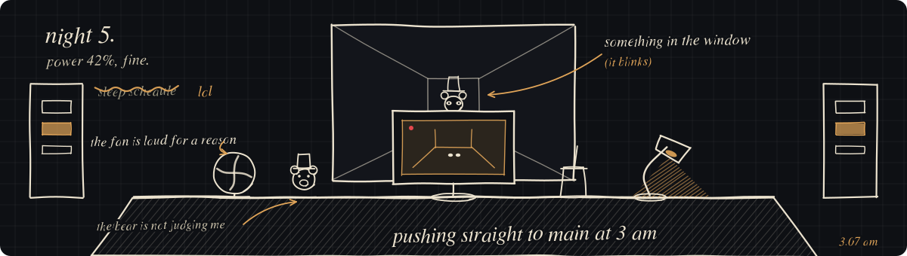
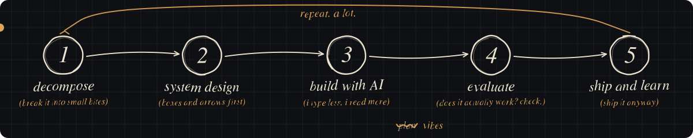

[English](README.md) · **简体中文**

## 🏹 关于这个主页

我喜欢发布 repo。发出来的大多是我自己喜欢、也觉得可能对别人有帮助的东西。我一直很积极,大约每 3 天更新一次。

如果这里的东西对你有用,请给仓库点个 ⭐,也欢迎 [关注我](https://github.com/MaxonT?tab=followers),这对我是很大的鼓励。

## 🧰 技术栈

  

## 🎮 下班时间

<i>凌晨三点,走廊在嗡嗡响。一分钟前还关着的门开了,光漏出来,像赶着去哪里。有人站在光里,或者站着的是我,动的是走廊。画面从不解释自己,我也是。不过构建还是绿的。</i>

凌晨三点调 bug 就像在熬 FNAF 的夜班,所以画了一张夜班保安室:

## 🧪 github2 · 实验室

一次专心做一个更大的开源系统。点卡片直接进入。

<table>
<tr>
<td width="50%" valign="top">

 · <a href="https://github.com/MaxonT/TRACES.md"><b>打开 TRACES.md →</b></a>

</td>
<td width="50%" valign="top">

 · <a href="https://github.com/MaxonT/aisync"><b>打开 aisync →</b></a>

</td>
</tr>
<tr>
<td width="50%" valign="top">

 · <a href="https://github.com/MaxonT/existence-trace"><b>打开 existence-trace →</b></a>

</td>
<td width="50%" valign="middle" align="center">
<b>它们之间的关系</b>  
agent 有了规则（AGENTS.md）， 还应该留下记录（TRACES.md）， 彼此通气（aisync）， 同一个循环也能用在人身上（existence-trace）。  
<a href="https://github.com/MaxonT?tab=repositories&q=top-&type=source">另外：按 star 排序的 <code>top-*</code> 清单（github1）→</a>
</td>
</tr>
</table>

## 🔥 最近在做的项目

每小时自动刷新一次，星数实时显示。

<!-- LATEST:START -->
| 项目 | ⭐ | 更新 | 做什么 |
|:--|:-:|:-:|:--|
| [**top-open-weight-coding-models**](https://github.com/MaxonT/top-open-weight-coding-models) |  | 2026-10-24 | Open-weight coding and agent models (Qwen Coder, DeepSeek, GLM, Kimi, Devstral, StarCoder) plus t... |
| [**top-flying-car-open-source**](https://github.com/MaxonT/top-flying-car-open-source) |  | 2026-10-24 | Open-source tools for flying cars, eVTOL and drones: flight controllers (PX4, ArduPilot, Betaflig... |
| [**top-ai-agent-guardrails**](https://github.com/MaxonT/top-ai-agent-guardrails) |  | 2026-10-24 | Guardrails for AI agents: sandboxes, human-in-the-loop approval, cost and budget limits, prompt-i... |
| [**top-chinese-rainbow-fart**](https://github.com/MaxonT/top-chinese-rainbow-fart) |  | 2026-10-24 | Chinese internet compliment generators, rainbow-fart plugins, meme makers and joke corpora, ranke... |
| [**top-free-javascript-courses**](https://github.com/MaxonT/top-free-javascript-courses) |  | 2026-10-24 | Every free way to learn JavaScript, ranked by GitHub stars |
| [**awesome-agent-workflows**](https://github.com/MaxonT/awesome-agent-workflows) |  | 2026-10-24 | Curated, star-ranked catalog of AI agent frameworks, coding-agent harnesses and workflow platform... |
| [**reeta**](https://github.com/MaxonT/reeta) |  | 2026-10-20 | Reeta: teach the AI student. HackTN26, Challenge #3 |
<!-- LATEST:END -->

## ⭐ 留个 star？

每一个 star 都告诉我有人觉得它有用，这就是我每 3 天更新一次的动力。 
点一下下面任意一个，我会开心一整天：

